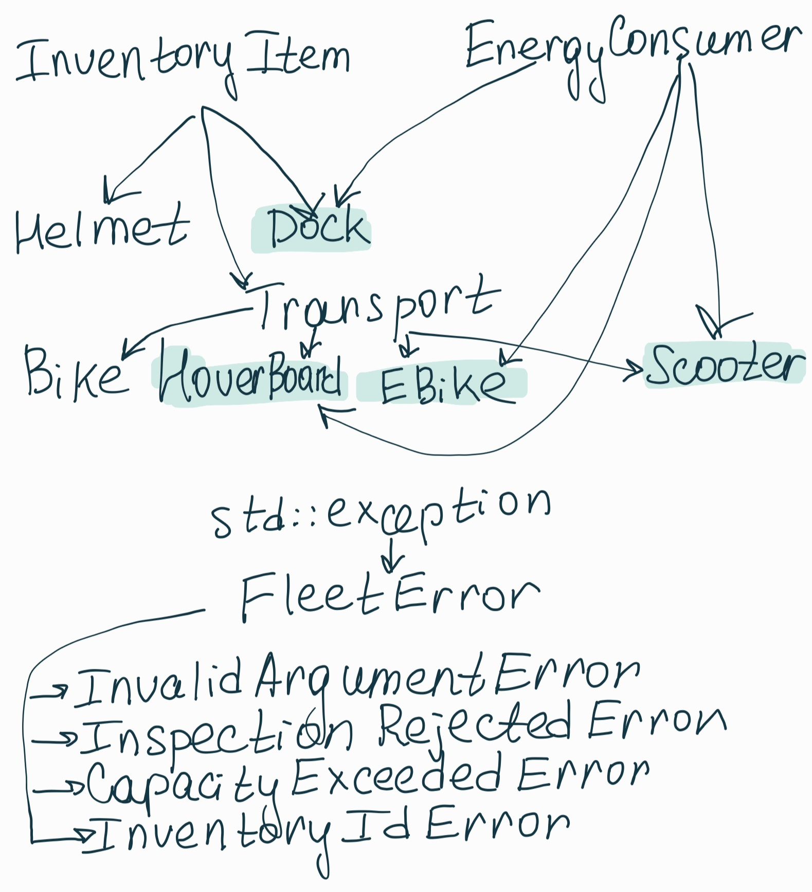

1. Сборка и запуск файла:
Для компиляции в терминале main.cpp выполнить:
g++ main.cpp -std=c++17 -Wall -Wextra -o main.exe
Для запуска программы:
.\main.exe
2. Схема наследования:
Схема представлена на рисунке. Зеленым выделены классы, для который используется множественное наследование. Классы InventoryItem - абстрактный базовый класс для всех объектов парка
EnergyConsumer - абстрактный базовый класс для работы с энергией, которую имеют некоторые объекты.
Transport - абстрактный класс для транспортных средств.
ServiceCenter - класс для проведения техосмотра до добавления транспортного средства.
Registry - шаблонный класс для хранения и учета всех вещей проката

3. Умные указатели:
unique_ptr - временное владение транспортным средством до прохождения техосмотра.
shared_ptr - хранение объектов парка в Registry.
weak_ptr - обращение к объекту, выбранному для отображения на витрине.
4. Исключения:
Исключения наследуются от базового класса FleetError, который в свою очередь наследует std::exception.
InvalidArgumentError - обрабатывает следующие ошибки:
попытка подать пустой объект на добавление, удалить несуществующий объект, попытка добавления в focus несуществующего объекта, выход сложности для транспорта за границы, отрицательная энергия для объекта, запрос на несуществующий тип объекта, неизвестный запрос, некорректный ввод.
InspectionRejectedError - отказ в прохождении техосмотра
CapacityExceededError - превышение вместимости парка
InventoryIdError - попытка добавить объект с существующим id.
5. Шаблоны:
Реализован шаблонный класс Registry для хранения и учета объектов парка. До запуска можно выставить требуемое capacity. Вместимость Cap известна и проверяется на этапе компиляции. Для Registry<InventoryItem, 100> написана полная специализация шаблона.
6. Креативная часть:
1) В качестве нового вида транспорта добавлен класс HoverBoard. 
2) Реализована функция theBestForNovice(). Она выводит технику с максимальной оценкой простоты.
3) Перегружен оператор == для класса InventoryItem, сравнивает id двух объектов.
4) Добавлена функция parkInfo(), которая выводит количество объектов в парке, суммарное суточное потребление энергии и список всех объектов.
7. Использование ИИ:
ИИ исползовался как консультант при изучении теоретических вопросов С++. Обсуждались названия исключений, так как хотелось назвать правильнее. При попытках реализации корректности ввода std::cin узнала про реализацию с помощью библиотеки limits для очистки некорректной строки.